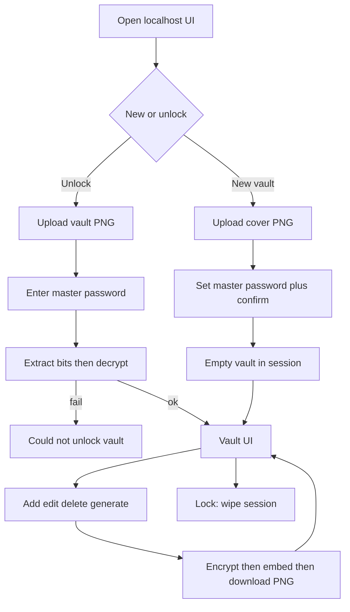

# Cambuci — implementation plan

This document is the spec for a **new** implementation. Ignore `old_code/` and git history. Implement the application from this plan; do not re-decide architecture unless a requirement is impossible as written.

## Product

**Cambuci** is a fully local password manager. Nothing is stored in the cloud. The vault is JSON, encrypted, then hidden inside a user-provided PNG using LSB steganography. The user downloads/saves that image; that image **is** the vault.

Users can:

- Create a new vault (empty JSON in a cover image)
- Unlock an existing vault image with a master password
- Add services (Gmail, GitHub, …) with one or more email/password pairs
- Store an existing password or generate a new one
- Edit / delete credentials
- Re-save the vault back into an image and download it

## Important crypto correction (must follow)

SHA-256 is a **hash**, not encryption. Hashing cannot recover passwords. The implementing AI **must**:

- **Encrypt** the vault with **AES-256-GCM**
- Use **SHA-256** inside **PBKDF2-HMAC-SHA256** to derive the AES key from the master password
- Optionally include a SHA-256 checksum of the plaintext JSON inside the payload for extra integrity (GCM already authenticates ciphertext)

Do not “encrypt with SHA-256”. Do not store plaintext JSON on disk.

## Stack

- **Runtime:** Node.js (current LTS)
- **Server:** Express, binds to `127.0.0.1` only (not `0.0.0.0`)
- **UI:** static HTML/CSS/vanilla JS (no React/Vue unless needed)
- **Uploads:** `multer` with **memory storage** (never write vault images or plaintext to disk)
- **Images:** `pngjs` (pixel-accurate PNG encode/decode)
- **Crypto:** Node `crypto` (`pbkdf2Sync` / `pbkdf2`, `createCipheriv` / `createDecipheriv` with `aes-256-gcm`)
- **Session:** `express-session` with an in-memory store; vault plaintext lives **only in RAM** while unlocked
- **Package type:** CommonJS or ESM; pick one and stay consistent (prefer ESM)

No database, no cloud APIs, no telemetry.

## Data model

Vault JSON shape — service name as object key; **multiple** logins as `email: password` pairs (emails unique per service):

```json
{
  "Gmail": {
    "alice@gmail.com": "existing-or-generated-password",
    "work@company.com": "other-password"
  },
  "GitHub": {
    "alice": "gh-password"
  }
}
```

Rules:

- Service names are case-sensitive strings, unique
- Login identifiers are strings (email or username)
- Values are password strings
- Empty vault is `{}`
- Validate: no empty service names; no empty login keys; passwords may be generated or pasted

## Binary payload (before steganography)

Build one binary blob, then embed it in the PNG:

1. Magic: 4 bytes `CBCI`
2. Version: 1 byte `0x01`
3. KDF salt: 16 bytes random
4. PBKDF2 iterations: uint32 BE (default **310000**)
5. AES-GCM IV/nonce: 12 bytes random
6. Ciphertext length: uint32 BE
7. Ciphertext
8. GCM auth tag: 16 bytes

**Key derivation:** `key = PBKDF2-HMAC-SHA256(masterPassword, salt, iterations, 32 bytes)`.

**Plaintext:** UTF-8 JSON of the vault object.

**Encryption:** AES-256-GCM, AAD = `magic || version || salt || iterations` so header tampering fails.

Wrong master password or corrupted image → generic error: “Could not unlock vault” (do not distinguish padding/tag/JSON parse).

## Steganography

- **Format:** PNG only (RGB or RGBA). Reject JPEG/WebP/GIF — lossy formats destroy LSBs.
- **Method:** sequential LSB in R, then G, then B (skip alpha). 1 bit per channel.
- **Framing:** embed `payloadLength` as uint32 BE, then payload bits.
- **Capacity:** `floor((width * height * 3) / 8) - 4` bytes. If payload does not fit, refuse and tell the user the image is too small (suggest a larger PNG).
- **Determinism:** same payload + same cover pixels → same output bits; always write a **new** PNG file for download (do not mutate the original path on disk unless the user downloads/saves it).
- **Cover image:** user uploads any PNG they choose. Saving re-embeds into that same image buffer (or a newly uploaded cover).

Do not implement DCT/frequency steganography. Keep LSB simple and documented.

## App flows



## Features to implement

1. **New vault** — cover PNG, master password (min 12 chars), confirm match.
2. **Unlock** — vault PNG + master password.
3. **Lock / close** — destroy session vault; leftover uploads stay only in RAM until request ends.
4. **List services** — sorted, searchable filter in the UI.
5. **Add service** — name + first login + password (paste or generate).
6. **Add login** under an existing service.
7. **Edit password** / **rename login** / **delete login**; delete service if last login removed (or explicit delete).
8. **Password generator** — length (default 20, range 12–64), toggles: uppercase, lowercase, digits, symbols; cryptographically random (`crypto.randomBytes`); copy-to-clipboard on the client.
9. **Save / download** — encrypt current vault, embed, `Content-Disposition` download as `.png`. Remind the user this file is the only copy.
10. **Capacity warning** before save if the image is too small.

Out of scope for v1: browser extension, cloud sync, TOTP, file attachments, sharing, mobile apps, JPEG.

## Suggested project layout

```
PLAN.md
package.json
README.md
src/
  server.js          # Express listen 127.0.0.1, static, routes
  crypto.js          # PBKDF2-SHA256, AES-256-GCM, payload pack/unpack
  stego.js           # PNG LSB embed/extract, capacity
  vault.js           # JSON validate, get/set/delete services and logins
  generatePassword.js
  sessionVault.js    # get/set/clear in-memory vault on req.session
public/
  index.html
  app.js
  styles.css
```

Keep crypto and stego **pure functions** (Buffer in, Buffer out) so they are easy to unit test without HTTP.

## HTTP API (all local)

Prefix `/api`. Never log bodies, passwords, or vault JSON.

- `POST /api/vault/new` — multipart: `image` (PNG), fields `masterPassword`, `masterPasswordConfirm`. Creates empty vault in session. Returns `{ ok: true, services: [] }`.
- `POST /api/vault/unlock` — multipart: `image`, `masterPassword`. Extract → decrypt → session. Returns service list (names only).
- `GET /api/vault` — requires unlocked session. Returns full vault JSON to the UI (localhost-only; still a reason to lock when idle).
- `POST /api/services` — `{ name, login, password }`.
- `PUT /api/services/:name/logins` — `{ login, password }` add or update.
- `PATCH /api/services/:name/logins` — `{ oldLogin, newLogin }` rename key.
- `DELETE /api/services/:name/logins` — `{ login }`.
- `DELETE /api/services/:name`.
- `POST /api/generate` — `{ length, uppercase, lowercase, digits, symbols }` → `{ password }` (generation can also be client-side; server-side is fine if using `crypto`).
- `POST /api/vault/save` — encrypt + embed using the PNG stored in session; return the PNG file. Prompt for master password again (do not keep it in session). Use a **new salt and IV** every save (never reuse nonce).
- `POST /api/vault/lock` — destroy session.

Session must keep: `vault` object, `coverPng` Buffer, `unlocked` boolean. Do **not** store the master password in the session.

**Save UX:** on Save, prompt for master password again. The cover PNG in session is reused unless the user uploads a new cover.

## UI (single page)

Simple, readable, no framework:

- Landing: “Unlock vault” vs “Create new vault”
- File picker (PNG) + password fields
- Main view: left list of services, right logins table (email/username, password with show/hide, copy)
- Forms for add service / add login
- Generator panel
- Buttons: Save image, Lock
- Errors as plain text; never dump stack traces to the UI

## Security requirements

- Listen on `127.0.0.1` only
- `express.json` size limit modest (e.g. 1mb); image size limit e.g. 10mb
- Timing-safe compare where comparing tags if done manually (GCM API already verifies)
- Constant generic unlock failure message
- Disable caching of API JSON (`Cache-Control: no-store`)
- Do not write `.json` vault files
- Do not put secrets in `console.log`
- `httpOnly` session cookie, `sameSite: 'strict'`
- README must say: losing the image or master password means losing the vault; steganography hides data, it is not extra encryption

## Implementation order

1. Scaffold Node/Express + static UI skeleton
2. `vault.js` JSON helpers + tests
3. `generatePassword.js` + tests
4. `crypto.js` round-trip tests (wrong password must fail)
5. `stego.js` embed/extract round-trip on a generated PNG; capacity errors
6. Wire unlock/new/save routes with in-memory session
7. CRUD routes + UI
8. Generator + copy/show-hide
9. README: how to run (`npm install`, `npm start`, open `http://127.0.0.1:PORT`)

## Tests

Use `node:test` (no extra runner required):

- Crypto round trip
- Wrong password / truncated payload
- Stego round trip and “image too small”
- Vault add/update/delete uniqueness of login keys

## README (write when implementing the app)

Short: local-only warning, PNG-only, master password, npm commands.
